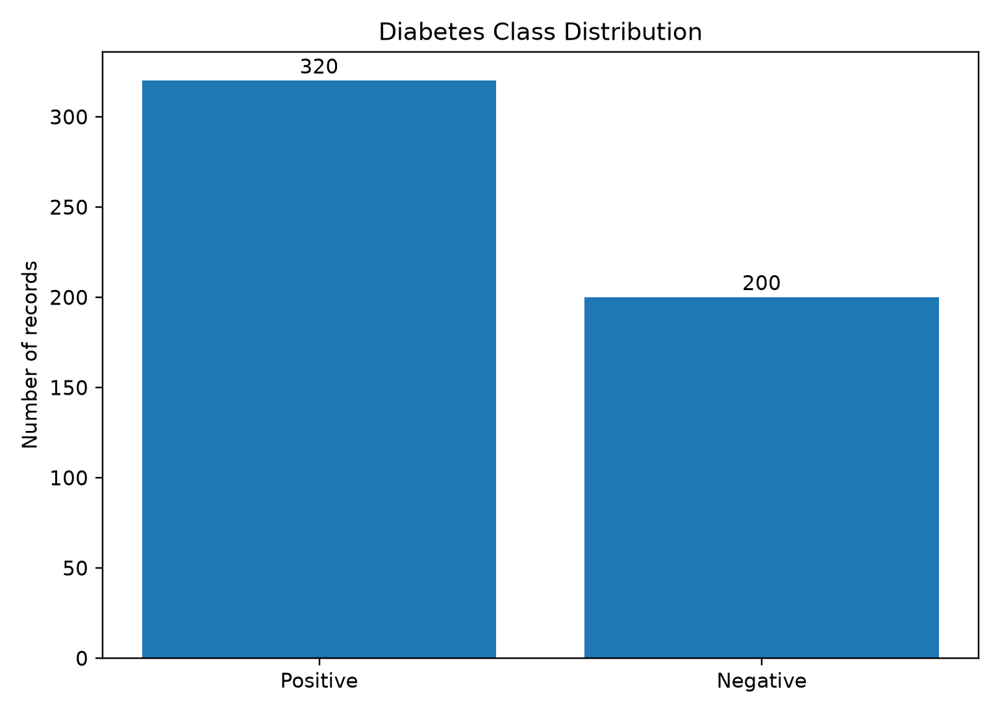
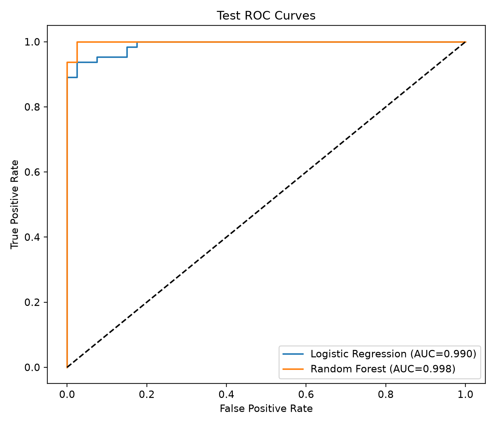
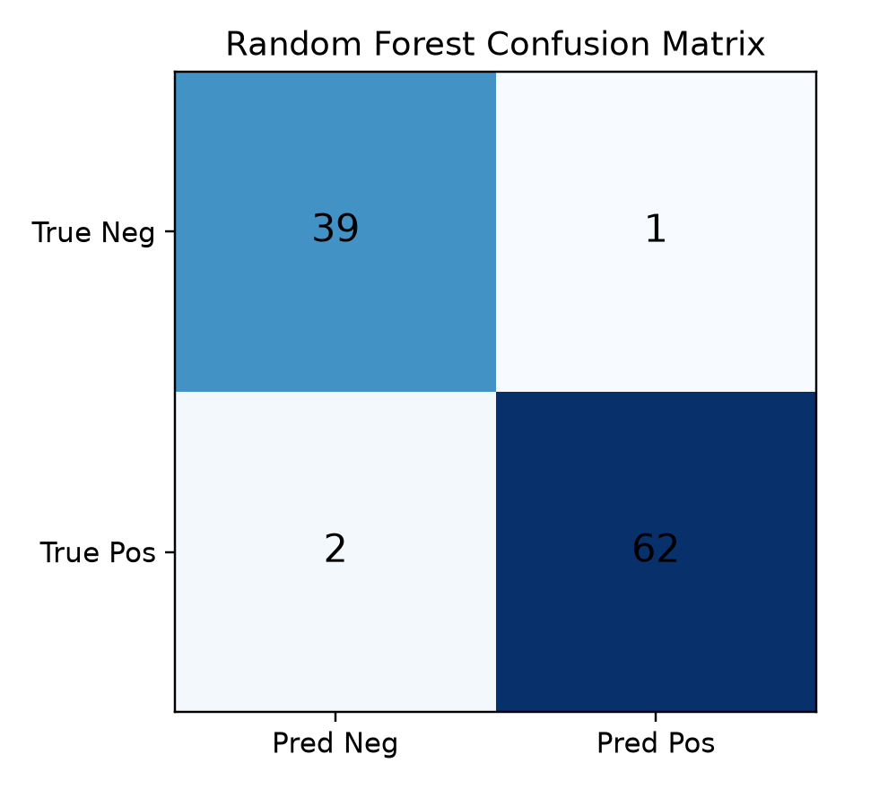
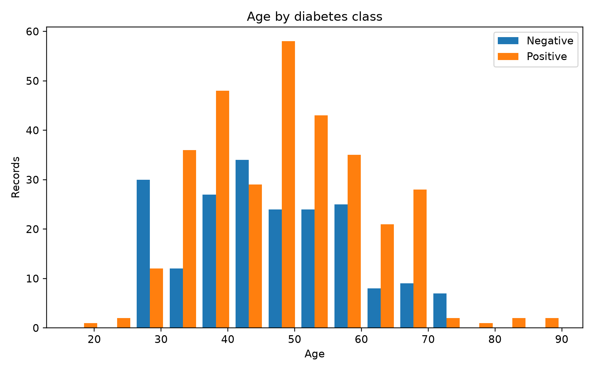
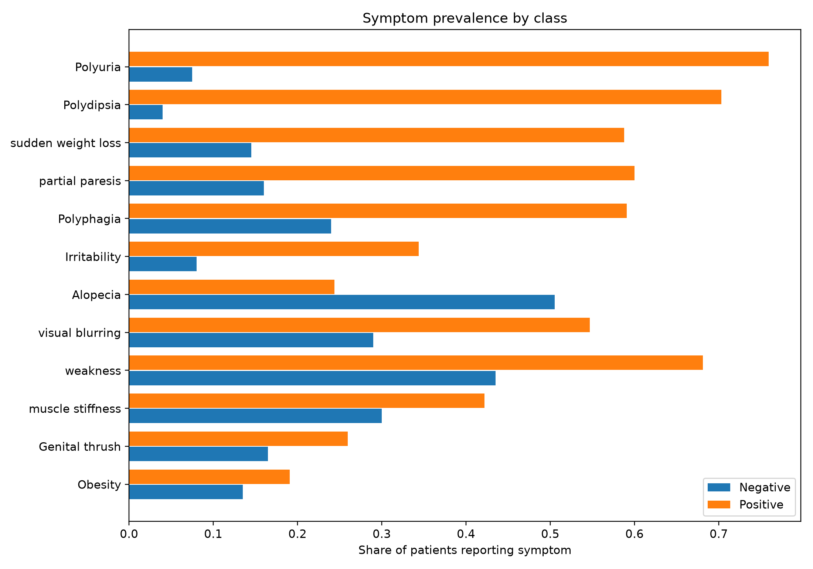
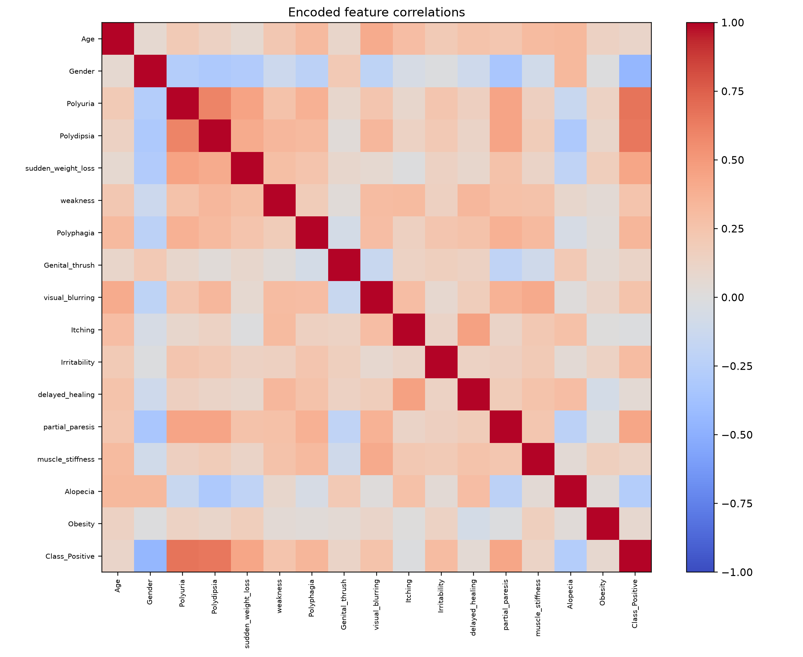
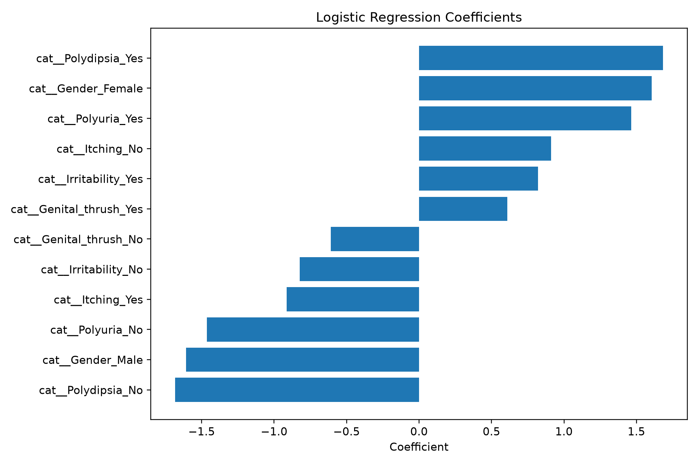
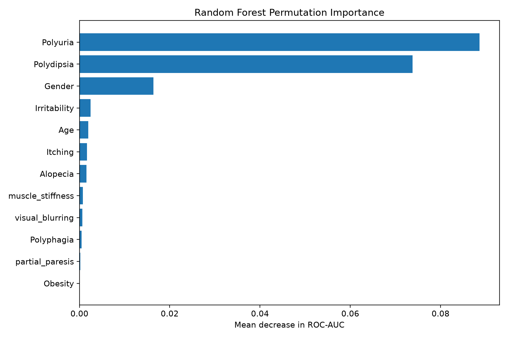

# Early-Stage Diabetes Classification Using Machine Learning

**A Reproducible Machine Learning Project Using Clinical Questionnaire Data**

## 1. Project Overview

This project explores the application of machine learning techniques to early-stage diabetes status classification using publicly available clinical questionnaire data.

Developed as an interdisciplinary learning project, it reflects my transition from a background in **Food Quality and Safety** toward **Precision Health, Medical Data Analysis, and Artificial Intelligence**.

The project compares two supervised machine learning algorithms:

- **Logistic Regression:** An interpretable baseline model for binary classification.
- **Random Forest:** An ensemble learning method capable of capturing nonlinear relationships and complex feature interactions.

The main objective is to evaluate their classification performance and investigate the predictive contributions of different clinical characteristics.

## 2. Research Objectives

This project addresses three research questions:

1. How effectively can diabetes classification status be predicted using demographic information and self-reported clinical symptoms?
2. Does Random Forest outperform Logistic Regression in this dataset?
3. Which clinical features contribute most strongly to model predictions?

The analysis emphasizes both **predictive performance** and **model interpretability**, which are important considerations in medical artificial intelligence.

## 3. Dataset

### Data Source

- **Repository:** UCI Machine Learning Repository
- **Dataset:** Early Stage Diabetes Risk Prediction Dataset
- **Source:** https://archive.ics.uci.edu/dataset/529/early+stage+diabetes+risk+prediction+dataset
- **Observations:** 520
- **Input Features:** 16
- **Target Variable:** Diabetes classification status (Positive / Negative)

The dataset contains demographic information and clinical symptoms collected through questionnaires, including:

| Feature | Description |
|---|---|
| Age | Patient age |
| Gender | Biological sex recorded in the dataset |
| Polyuria | Frequent urination |
| Polydipsia | Excessive thirst |
| Sudden Weight Loss | Unexplained weight reduction |
| Weakness | General physical weakness |
| Polyphagia | Excessive hunger |
| Visual Blurring | Blurred vision |
| Obesity | Obesity status |
| Class | Diabetes classification label |

Additional variables include itching, irritability, delayed healing, partial paresis, muscle stiffness, alopecia, and genital thrush.

### Target Distribution

The dataset consists of:

- **Positive:** 320 observations (61.54%)
- **Negative:** 200 observations (38.46%)



The data represent questionnaire-based diabetes classification rather than longitudinal disease outcomes. Therefore, the models should not be interpreted as predicting future diabetes incidence in the general population.

## 4. Methodology

The project follows a structured machine learning workflow.

### Step 1: Data Loading and Inspection

The dataset was imported using Python and pandas.

Initial inspection included:

- Dataset dimensions and variable types
- Missing-value inspection
- Duplicate-record inspection
- Target class distribution
- Descriptive statistics

### Step 2: Exploratory Data Analysis

Exploratory analysis was conducted to investigate patterns within the clinical data.

The analysis included:

- Age distributions across diabetes classification groups
- Differences in symptom prevalence
- Correlations among encoded clinical variables

### Step 3: Data Preprocessing

The preprocessing workflow included:

- Stratified training-test splitting
- Numerical feature standardization
- Categorical variable encoding
- Missing-value handling through preprocessing pipelines

The dataset was divided into:

- **Training set:** 80%
- **Test set:** 20%

A fixed random seed (`random_state=42`) was used for reproducibility.

Preprocessing transformations were fitted within the training workflow to reduce the risk of data leakage.

### Step 4: Model Development

Two classification models were implemented using scikit-learn.

**Model 1: Logistic Regression**

Logistic Regression was selected as an interpretable baseline model for binary classification.

**Model 2: Random Forest**

Random Forest was selected to investigate whether a more flexible ensemble model could improve classification performance.

### Step 5: Cross-Validation and Model Evaluation

Five-fold stratified cross-validation was performed on the training data.

Final performance was evaluated on the held-out test set using:

- Accuracy
- Precision
- Recall
- F1-score
- Receiver Operating Characteristic Area Under the Curve (ROC-AUC)

Recall was considered particularly relevant because false-negative classifications may carry important consequences in medical applications.

However, clinical utility cannot be established from these metrics alone.

## 5. Model Performance

### Test Set Results

| Evaluation Metric | Logistic Regression | Random Forest |
|---|---:|---:|
| Accuracy | 0.9327 | 0.9712 |
| Precision | 0.9831 | 0.9841 |
| Recall | 0.9062 | 0.9688 |
| F1-score | 0.9431 | 0.9764 |
| ROC-AUC | 0.9902 | 0.9992 |

Random Forest achieved higher Accuracy, Recall, F1-score, and ROC-AUC than Logistic Regression on the held-out test set.

This suggests that the ensemble model was better suited to the observed classification patterns under the current experimental setup.

However, the results come from a relatively small dataset and a single held-out test split. They should not be interpreted as evidence of reliable performance across independent clinical populations.

### ROC Curve Comparison



The ROC curves illustrate the models' abilities to distinguish positive and negative observations across classification thresholds.

### Confusion Matrix: Logistic Regression


### Confusion Matrix: Random Forest



## 6. Exploratory Data Analysis

### Age Distribution



This visualization compares the age distributions of observations classified as diabetes-positive and diabetes-negative.

### Clinical Symptom Prevalence



The comparison illustrates differences in clinical characteristic prevalence between the two groups.

In this dataset, polyuria and polydipsia show particularly large differences between the positive and negative classes.

These descriptive patterns should not be interpreted as causal relationships.

### Feature Correlation Analysis



The correlation heatmap summarizes pairwise relationships among encoded features.

Correlations may highlight potentially informative associations, but they do not establish clinical causation.

## 7. Model Interpretability

Interpretability is an important consideration when applying machine learning techniques to healthcare-related data.

### Logistic Regression Coefficients



The coefficient visualization illustrates the directions and relative magnitudes of selected encoded feature coefficients.

Coefficients depend on the encoding and preprocessing choices and should not be interpreted as direct causal effects.

### Random Forest Permutation Feature Importance



Permutation importance was used to examine the contribution of original input features to the Random Forest model's predictive performance.

Feature importance reflects model dependence on particular variables within the evaluated dataset.

It does not establish that a variable causes diabetes.

## 8. Technologies and Tools

| Technology | Application |
|---|---|
| Python | Main programming language |
| pandas | Data loading and processing |
| NumPy | Numerical computation |
| Matplotlib | Data visualization |
| scikit-learn | Machine learning and evaluation |
| openpyxl | Excel data handling |
| Visual Studio Code | Development environment |
| GitHub | Version control and project documentation |

## 9. Project Structure

```text
diabetes-ml-classification/
│
├── README.md
├── requirements.txt
├── .gitignore
│
├── diabetes/
│   └── run.py
│
├── data/
│   └── README.md
│
└── results/
    ├── figures/
    │   ├── class_distribution.png
    │   ├── age_distribution_by_class.png
    │   ├── symptom_prevalence_comparison.png
    │   ├── correlation_heatmap.png
    │   ├── roc_curves.png
    │   ├── confusion_matrix_logistic_regression.png
    │   ├── confusion_matrix_random_forest.png
    │   ├── logistic_top_coefficients.png
    │   └── random_forest_permutation_importance.png
    │
    └── tables/
        ├── data_summary.csv
        ├── age_stats_by_class.csv
        ├── model_metrics.csv
        ├── logistic_top_coefficients.csv
        ├── random_forest_permutation_importance.csv
        └── top_symptom_prevalence_differences.csv
```

The original dataset is not included in the public repository. Instructions for obtaining it are provided in `data/README.md`.

## 10. Reproducibility

### Step 1: Clone the Repository

```bash
git clone https://github.com/YUJIARUAN/diabetes-ml-classification.git
cd diabetes-ml-classification
```

### Step 2: Install Dependencies

Python 3.11 or a compatible version is recommended.

```bash
python -m pip install -r requirements.txt
```

### Step 3: Prepare the Dataset

Download the Early Stage Diabetes Risk Prediction Dataset from the official UCI repository.

Prepare the Excel file using the following filename:

```text
diabetes_dataset.xlsx
```

Place it in the `data/` directory.

The expected path is:

```text
data/diabetes_dataset.xlsx
```

### Step 4: Run the Analysis

From the repository root, execute:

```bash
python diabetes/run.py
```

The script performs data preprocessing, trains the classification models, evaluates their performance, and generates results in the configured output directories.

**Important:** These reproduction instructions assume that the script has been updated to use the English dataset filename and the directory structure described above.

## 11. Limitations

Several limitations should be considered when interpreting the findings.

**Small Sample Size**

The dataset contains only 520 observations, limiting the strength of conclusions regarding generalizability.

**Potential Selection Bias**

The data were collected using questionnaires in a clinical setting and may not represent the general population.

**Limited External Validity**

No independent external clinical dataset was used to validate model performance.

**Potential Repeated Feature Patterns**

Identical or highly similar feature patterns may occur across observations, potentially affecting the interpretation of internal evaluation results.

**Lack of Longitudinal Outcomes**

The target variable represents diabetes classification status rather than a prospectively observed future diagnosis.

**No Causal Inference**

Neither model coefficients nor feature importance estimates establish causal relationships between symptoms and disease.

**Clinical Application**

The trained models are intended for educational exploration and are not suitable for clinical diagnosis or medical decision-making without substantially more rigorous validation.

## 12. Learning Outcomes and Future Directions

Through this project, I gained practical experience in applying statistical and machine learning techniques to health-related data.

The project helped me understand how data preprocessing, model selection, evaluation metrics, and interpretability influence the reliability of classification systems.

It also highlighted the importance of distinguishing predictive accuracy from clinical validity.

Building on my undergraduate background in Food Quality and Safety, I am interested in extending these methodological skills to interdisciplinary research involving nutritional information, clinical measurements, and data-driven precision health.

Potential future directions include:

- External validation using independent clinical datasets
- Model calibration and classification threshold analysis
- More robust evaluation of repeated observations and dataset shift
- Integration of nutritional and clinical data when appropriately linked data become available
- Exploration of interpretable machine learning methods for precision health research

## 13. References and Data Acknowledgement

**Data Source**

UCI Machine Learning Repository. *Early Stage Diabetes Risk Prediction Dataset.*

https://archive.ics.uci.edu/dataset/529/early+stage+diabetes+risk+prediction+dataset

Please consult the original repository entry for the dataset authors, associated publication, licensing information, and recommended academic citation.

---

**Project Type:** Independent Learning Project

**Research Area:** Medical Artificial Intelligence, Clinical Data Analysis, Machine Learning

**Disclaimer:** This repository is intended solely for educational and research training purposes. It does not provide a clinically validated diagnostic system.
